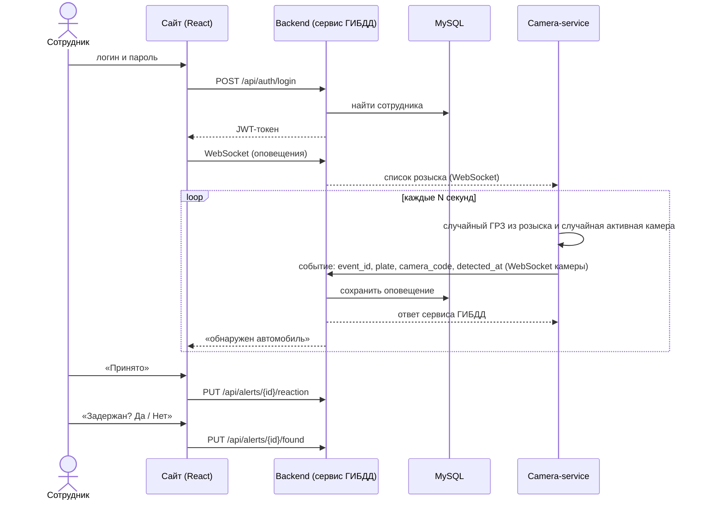

# Система оперативного розыска ГИБДД

Учебный проект: сотрудник ГИБДД ведёт список разыскиваемых автомобилей и получает оповещение, когда камера «видит» один из них. Реальных камер нет: их имитирует отдельный **сервис камер** (`camera-service`).

Проект состоит из трёх частей:

| Папка | Что это |
| --- | --- |
| `backend` | Сервис ГИБДД: API на FastAPI, база MySQL, приём событий от камер, оповещения |
| `camera-service` | Сервис камер: имитатор на чистом Python, отправляет события обнаружения в `backend` по WebSocket |
| `web-frontend` | Сайт сотрудника на React |
| `docs` | ER-диаграмма базы данных |

Мобильное приложение в репозиторий не входит.


## Как это работает

1. Сотрудник входит по логину и паролю, сервер выдаёт JWT-токен.
2. Сайт открывает WebSocket и получает оповещения.
3. Список розыска передаётся сервису камер **по WebSocket** (а не через HTTP).
4. Раз в заданный интервал `camera-service` выбирает случайный автомобиль из розыска и случайную **активную** камеру, формирует событие и отправляет его в сервис ГИБДД через WebSocket-соединение этой камеры.
5. Сервис ГИБДД сохраняет оповещение в БД и отправляет его на сайт (и на почту).
6. На сайте появляется окно «Обнаружен автомобиль», открывается карта с подсвеченной камерой.
7. После «Принято» сайт спрашивает «Автомобиль задержан?». «Да» меняет статус на «Найден», «Нет» возвращает «В розыске».



Ручная фиксация: событие можно создать и вручную запросом `POST /v1/detections` к сервису камер (см. ниже).

## Сервис камер (`camera-service`)

Написан на Python без веб-фреймворков (стандартный `http.server`).

### Состав

| Модуль | Назначение |
| --- | --- |
| `config.py` | Настройки из переменных окружения |
| `cameras.py` | Загрузка камер из JSON-файла (ключ `cameras`), проверка полей и уникальности кодов |
| `watchlist.py` | Список розыска (ГРЗ), нормализация номеров |
| `emitter.py` | Имитатор: периодическая и ручная фиксация, формирование события |
| `ws_client.py` | WebSocket-клиенты камер (`CameraHub`), ошибки доставки `DeliveryError`, `DeliveryRejected` |
| HTTP-сервер | Локальный HTTP: health, список камер, ручная фиксация |
| HTTP-клиент | Устаревший модуль, оставлен только ради реэкспорта ошибок. События идут только по WebSocket |

### Камеры

Файл с камерами должен содержать объект с ключом `cameras`. У каждой камеры поля:

| Поле | Описание |
| --- | --- |
| `code` | Уникальный код камеры |
| `address` | Адрес |
| `latitude`, `longitude` | Координаты |
| `type` | Тип камеры (необязательно) |
| `speed_limit` | Ограничение скорости (необязательно, по умолчанию 0) |
| `active` | Работает ли камера (по умолчанию `true`) |

Для каждой камеры создаётся свой WebSocket-клиент. Неактивные камеры события не отправляют.

### Формат события

```json
{
  "event_id": "uuid hex",
  "plate": "А123БВ45",
  "camera_code": "CAM-01",
  "detected_at": "2026-10-23T12:00:00+00:00"
}
```

### HTTP-интерфейс

Все запросы, кроме `/health`, требуют заголовок `X-Service-Token` со значением `SERVICE_TOKEN`. Если токен не настроен, сервис отвечает 503, если неверный, то 401.

| Метод и путь | Что делает |
| --- | --- |
| `GET /health` | Состояние: число камер, размер списка розыска, число подключённых WebSocket-клиентов |
| `GET /v1/cameras` | Список камер |
| `GET /v1/watchlist` | Текущий список розыска (только чтение) |
| `POST /v1/detections` | Ручная фиксация. Тело: `{"plate": "...", "camera_code": "..."}`, `camera_code` необязателен (тогда берётся случайная активная камера) |
| `PUT /v1/watchlist` | Отключён, ответ 405: список передаётся по WebSocket |

Коды ошибок `POST /v1/detections`:

| Код | Причина |
| --- | --- |
| 400 | Нет поля `plate`, неверный тип `camera_code` или тело не JSON |
| 404 | Ручная фиксация отключена (`ENABLE_MANUAL_DETECTIONS=false`) |
| 413 | Тело больше 64 КБ |
| 422 | Неизвестная или отключённая камера |
| 502 | Сервис ГИБДД недоступен или отклонил событие |

## ER-диаграмма базы данных


Файлы: [PNG](docs/er-diagram.png), [SVG](docs/er-diagram.svg), исходник [DOT](docs/er-diagram.dot). Диаграмма построена по `backend/app/models.py`.

| Таблица | Назначение |
| --- | --- |
| `departments` | Подразделения ГИБДД |
| `employees` | Сотрудники: логин, пароль, ФИО, должность, подразделение |
| `vehicles` | Автомобили: ГРЗ (уникален), модель, цвет, VIN |
| `violation_categories` | Справочник причин розыска (угон, ДТП и т. д.) |
| `wanted_vehicles` | Записи розыска: автомобиль, кто ведёт, причина, статус, где и когда замечен |
| `cameras` | Камеры видеофиксации с координатами |
| `alerts` | Оповещения: что и где обнаружено, реакция сотрудника, найден или нет |
| `user_logs` | Журнал действий. Таблица создана, но в коде пока не используется |

Важно знать:

- У автомобиля может быть несколько записей в `wanted_vehicles` (история), но **активная только одна**.
- `alerts.vehicle_plate` и `alerts.address` хранят копию значений на момент оповещения, чтобы история не менялась при правке справочников.
- `wanted_vehicles.fix_camera_id` ссылается на камеру по значению, внешнего ключа нет.

## Технологии

- **Backend:** Python, FastAPI, SQLAlchemy, MySQL, JWT (python-jose), WebSocket
- **Camera-service:** Python (стандартная библиотека), WebSocket
- **Frontend:** React 18, Redux Toolkit, React Router, Tailwind CSS, Axios, React-Toastify

## Структура

```
backend/            сервис ГИБДД на FastAPI
  app/main.py         точка входа, подключение роутов, WebSocket
  app/models.py       модели таблиц БД
  app/routes/         эндпойнты: auth, wanted, alerts, cameras, employees, vehicles
  seed.py             наполнение БД тестовыми данными
camera-service/     сервис камер (имитатор)
web-frontend/       сайт на React
  src/pages/          страницы
  src/contexts/       приём оповещений по WebSocket
  public/             карта города и варианты карты с подсвеченной камерой
docs/               ER-диаграмма
```

## Запуск

Нужны Python 3.12, Node.js 18+ и MySQL.

**1. База данных**

```sql
CREATE DATABASE gibdd_db CHARACTER SET utf8mb4;
```

**2. Backend**

```bash
cd backend
cp .env.example .env
python -m venv venv
venv\Scripts\activate
pip install -r requirements.txt
python seed.py
uvicorn app.main:app --reload --port 8000
```

Проверка: <http://localhost:8000/>, документация API: <http://localhost:8000/docs>

**3. Camera-service**

```bash
cd camera-service
# TODO: команда запуска и переменные окружения (SERVICE_TOKEN, ENABLE_MANUAL_DETECTIONS, адрес backend, интервал, путь к файлу камер)
```

**4. Frontend**

```bash
cd web-frontend
cp .env.example .env
npm install
npm start
```

Сайт откроется на <http://localhost:3000>.

**Тестовые сотрудники** (создаёт `seed.py`):

| Логин | Пароль | Должность |
| --- | --- | --- |
| `ivanov_ai` | `Ivanov2024` | Инспектор ДПС |
| `petrova_ea` | `Petrova2024` | Инспектор ДПС |
| `sidorov_mk` | `Sidorov2024` | Старший инспектор |
| `kuznetsova_ov` | `Kuznec2024` | Инспектор ДПС |
| `belozerov_rv` | `Admin2024` | Администратор |

## Страницы и кнопки

| Страница | Кнопка | Что происходит |
| --- | --- | --- |
| Вход | «Войти в систему» | Проверка логина и пароля, переход на главную |
| Главная | «Принято» / «Отклонить» | Сохраняет реакцию на ожидающее оповещение |
| Мой розыск | «+ Добавить в розыск» | Два шага: выбор ГРЗ, затем причины |
| Мой розыск | «Удалить из розыска» | Удаляет выбранную строку после подтверждения |
| База розыска | «Взять себе» | Передаёт розыск чужого автомобиля вам |
| Карта | «Увеличить» / «Уменьшить» / «Сброс» | Масштаб карты |
| Карта | «Снять подсветку» | Возврат к общей карте |
| История | «Сегодня» / «Неделя» / «Месяц» | Фильтр оповещений по периоду |
| Окно оповещения | «Принято», затем «Да» / «Нет» | Реакция и итог: задержан или нет |

## Известные ограничения

- Пароли сотрудников хранятся в БД открытым текстом, для реального использования нужно хеширование (bcrypt).
- Камеры имитируются случайным выбором, а не распознаванием номеров.
- Файлы `.env` с секретами в репозиторий не входят, используйте `.env.example`.
