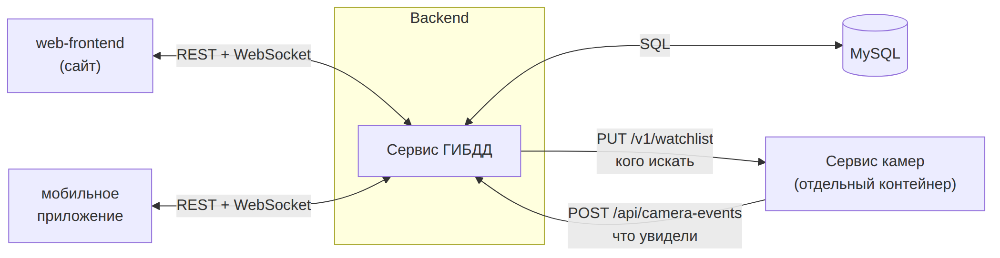
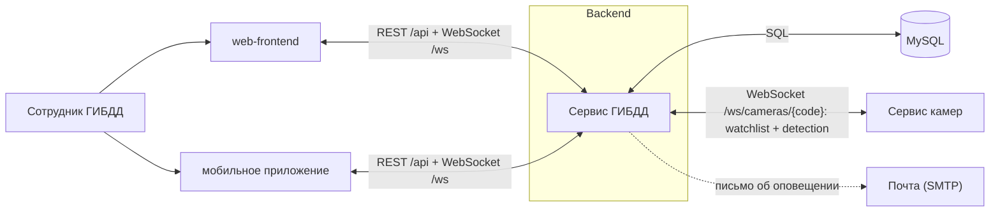
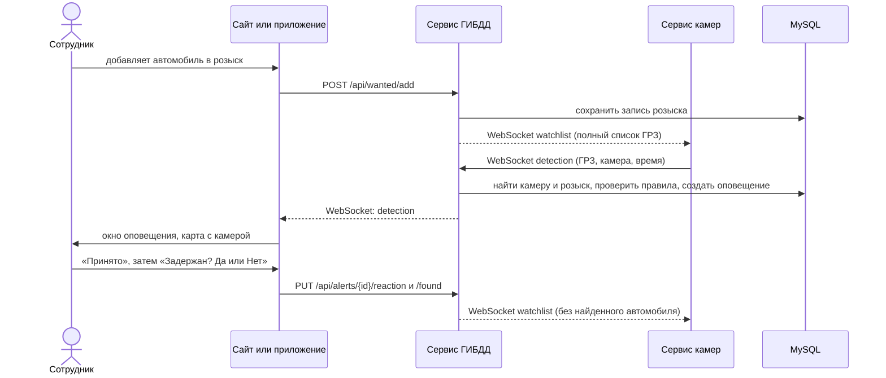
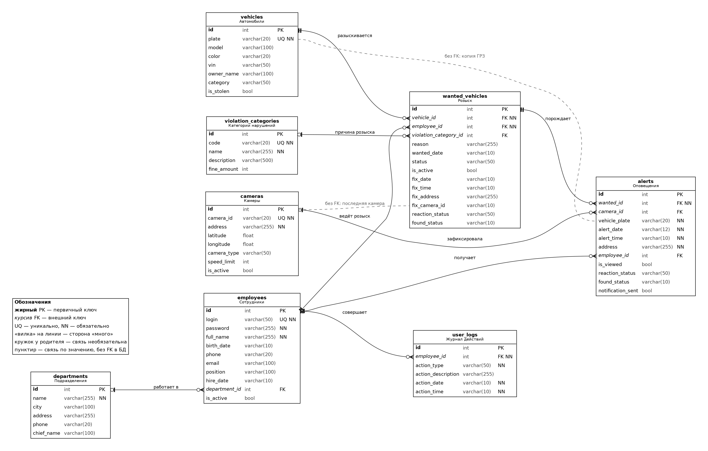

# Система оперативного розыска ГИБДД

Учебный проект: сотрудник ГИБДД ведёт список разыскиваемых автомобилей и получает оповещение, когда камера «видит» один из них. Работает на сайте и в мобильном приложении. Реальных камер нет: их изображает отдельный **сервис камер**, который общается с сервисом ГИБДД по протоколу.



## Из чего состоит проект

Репозиторий содержит пять частей. У каждой есть свой README и своя папка `docs/` с подробной документацией.

| Папка | Что это | README | Документация |
|---|---|---|---|
| [`backend/`](backend) | **Сервис ГИБДД**: REST API и WebSocket (FastAPI), база MySQL, приём событий от камер | [backend/README.md](backend/README.md) | [backend/docs/](backend/docs) |
| [`camera-service/`](camera-service) | **Сервис камер**: отдельный сервис, имитирует камеры видеофиксации | [camera-service/README.md](camera-service/README.md) | [camera-service/docs/](camera-service/docs) |
| [`web-frontend/`](web-frontend) | Веб-интерфейс сотрудника (React) | [web-frontend/README.md](web-frontend/README.md) | [web-frontend/docs/](web-frontend/docs) |
| [`AvtoDozor/`](AvtoDozor) | Мобильное приложение сотрудника (React Native, Android) | [AvtoDozor/README.md](AvtoDozor/README.md) | |
| [`docs/`](docs) | Материалы по проекту в целом: архитектура, Docker, ER-диаграмма | [docs/README.md](docs/README.md) | |

Всё, кроме мобильного приложения, запускается в Docker одной командой: [docs/docker.md](docs/docker.md).

## Как части связаны между собой



- Сайт и приложение разговаривают **только с сервисом ГИБДД**. О существовании сервиса камер они не знают: для них оповещение это сообщение по WebSocket.
- **Все правила розыска проверяет сервис ГИБДД.** Клиенты лишь удобно показывают результат и подсказывают ошибки.
- **Камеры вынесены за пределы backend.** Это отдельный процесс и контейнер без доступа к базе данных. Они получают от сервиса ГИБДД список разыскиваемых ГРЗ и присылают ему события. Так они ведут себя, как настоящая система камер, которой можно будет заменить имитацию без изменений в остальном коде. Подробнее, зачем так сделано: [docs/architecture.md](docs/architecture.md).
- Формат сообщений между сервисами (**WebSocket**, по одному соединению на камеру): [camera-service/docs/protocol.md](camera-service/docs/protocol.md).

## Как проходит оповещение



## Бизнес-правила

Правила хранения и проверки находятся в сервисе ГИБДД ([`routes/`](backend/app/routes) и [`services/`](backend/app/services)).

### Розыск

1. **Одна активная запись на автомобиль.** Поставить в розыск автомобиль, у которого уже есть активная запись (у любого сотрудника), нельзя.
2. **Только известные автомобили.** В розыск ставятся автомобили из справочника `vehicles`; ГРЗ вне справочника отклоняется.
3. **Причина розыска.** Берётся из справочника причин. Если введена другая, создаётся новая категория.
4. **У записи один владелец** сотрудник, который поставил автомобиль в розыск или взял его себе. Снять с розыска может только он.
5. **Передача розыска.** Сотрудник может взять чужой розыск себе (на сайте). Запись прежнего владельца закрывается (статус «Передан»), создаётся новая, данные последней фиксации автомобиля переносятся. Нельзя взять свою запись или запись, которая уже не «В розыске».
6. **Снятие не стирает данные.** Запись получает статус «Удален» и остаётся в базе как история.
7. **Камеры знают о розыске.** Сервис ГИБДД отправляет сервису камер полный список разыскиваемых ГРЗ при запуске, после каждого изменения розыска и периодически. В список входят автомобили в статусе «В розыске».

### Оповещения

8. **Оповещение создаётся по событию камеры.** Сервис ГИБДД сам оповещений не придумывает: он принимает от сервиса камер событие «камера увидела автомобиль» и создаёт оповещение, если автомобиль в розыске.
9. **Оповещение получает тот, кто ведёт розыск.** Видит и меняет его только адресат.
10. **Оповещения не повторяются без нужды.** Пока сотрудник не ответил на оповещение по этому розыску, новые не создаются. После ответа проходит ещё пауза (по умолчанию 120 секунд). Повторная отправка того же события от камеры оповещения не задваивает.
11. **Оповещение не теряется.** Если страница или приложение были закрыты, оповещение сохраняется с пометкой «не доставлено» и показывается среди оповещений без реакции. Письмо на служебную почту (если настроена почта) отправляется в любом случае.
12. **Реакция сотрудника.** Он принимает оповещение («Принято») или отклоняет («Отклонено»; это можно сделать на главной странице сайта).
13. **Результат розыска.** После «Принято» сотрудника спрашивают «Автомобиль задержан?».
    «Да» переводит запись в статус «Найден», сервис камер получает обновлённый список, и оповещения по ней прекращаются.
    «Нет» оставляет статус «В розыске», поиск продолжается.

### История и отчёты

14. **История** показывает оповещения только текущего сотрудника, от новых к старым, не больше 200. Период: сегодня, неделя (7 дней), месяц (30 дней) или всё время.
15. **Отчёты.** Историю можно выгрузить в Word или Excel (мобильное приложение).

### Доступ

16. **Вход по логину и паролю.** Отключённый сотрудник войти не может. После входа выдаётся токен на 30 минут, затем нужно войти снова.
17. **Права одинаковы у всех сотрудников.** Должность («Администратор», «Инспектор ДПС») нигде не влияет на доступ.
18. **Сервисы доверяют друг другу по общему секрету.** Сервис камер подписывает события токеном `SERVICE_TOKEN`, сервис ГИБДД подписывает им список розыска. Запрос с чужим токеном отклоняется.

### Статусы

| Что | Значения | Когда |
|---|---|---|
| Запись розыска | `В розыске` | Поставлена в розыск, или результат розыска «Нет» |
| | `Найден` | Сотрудник ответил, что автомобиль задержан |
| | `Передан` | Розыск взял другой сотрудник |
| | `Удален` | Владелец снял автомобиль с розыска |
| Реакция на оповещение | `Ожидает` | Оповещение создано, ответа нет |
| | `Принято`, `Отклонено` | Ответ сотрудника |
| Результат | `Да`, `Нет` | Задержан ли автомобиль |
| Статус в истории | `Найден`, `Принято`, `Отклонено`, `Ожидает` | Выводится из реакции и результата, «Найден» главнее остальных |

## ER-диаграмма



Файлы: [PNG](docs/er-diagram.png), [SVG](docs/er-diagram.svg), исходник [DOT](docs/er-diagram.dot). Диаграмма построена по [`backend/app/models.py`](backend/app/models.py). Все поля и связи с пояснениями: [backend/docs/database.md](backend/docs/database.md).

| Таблица | Назначение |
|---|---|
| `departments` | Подразделения ГИБДД |
| `employees` | Сотрудники: логин, пароль, ФИО, должность, подразделение |
| `vehicles` | Автомобили: ГРЗ (уникален), модель, цвет |
| `violation_categories` | Справочник причин розыска |
| `wanted_vehicles` | Записи розыска: автомобиль, владелец, причина, статус, где и когда замечен |
| `cameras` | Справочник камер с координатами (сами камеры живут в сервисе камер) |
| `alerts` | Оповещения: что, где и кому, доставлено ли, реакция и результат |
| `user_logs` | Журнал действий (создаётся, но в коде пока не используется) |

## Быстрый запуск в Docker

Нужен только [Docker Desktop](https://www.docker.com/products/docker-desktop/). Подробная инструкция и решение проблем: [docs/docker.md](docs/docker.md).

```powershell
copy .env.example .env                                 
copy backend\seed_users.example.json backend\seed_users.json   
docker compose up --build
```

Когда всё запустится (около минуты после сборки), откройте сайт http://localhost:3000 и войдите логином и паролем из `backend/seed_users.json`. Документация API: http://localhost:8000/docs.

**Тестовые сотрудники.** Логины и пароли лежат не в коде, а в файле `backend/seed_users.json`. Шаблон с данными для демонстрации: [`backend/seed_users.example.json`](backend/seed_users.example.json). Настоящий `seed_users.json` в git не попадает.

**Демонстрационный режим.** Чтобы не ждать минуту: в `.env` поставьте `CAMERA_INTERVAL_SECONDS=10`, `FOUND_PROMPT_DELAY_MS=10000` и `ALERT_COOLDOWN_SECONDS=20`. Оповещение можно вызвать и вручную, не дожидаясь камер: [пример команды](camera-service/README.md#ручная-фиксация).

**Мобильное приложение** в Docker не запускается: оно подключается к уже работающему сервису ГИБДД (порт 8000). Установка и запуск: [AvtoDozor/README.md](AvtoDozor/README.md).

**Без Docker** части запускаются по отдельности: [backend](backend/README.md#быстрый-старт-без-docker), [сервис камер](camera-service/README.md#запуск), [сайт](web-frontend/README.md#быстрый-старт-без-docker).

## Структура репозитория

```
backend/            сервис ГИБДД: API, база, приём событий; README и docs/
camera-service/     сервис камер; README и docs/
web-frontend/       веб-интерфейс; README и docs/
AvtoDozor/          мобильное приложение
docs/               архитектура, Docker, ER-диаграмма
docker-compose.yml  запуск всей системы
.env.example        настройки для Docker
```

## Проверка качества

| Часть | Автотесты | Как запустить |
|---|---|---|
| Сервис ГИБДД | 65 тестов: правила оповещений, отправка списка камерам, менеджер WebSocket, загрузка тестовых сотрудников, почта | `python -m unittest discover -s tests -v` в папке `backend` |
| Сервис камер | 58 тестов: протокол, повторы, ошибки, согласованность с backend, оба сервиса вместе | `python -m unittest discover -s tests -v` в папке `camera-service` |
| Мобильное приложение | 26 тестов: логика и прохождение всех экранов и кнопок | `npm test` в папке `AvtoDozor` |
| Веб-интерфейс | Ручной чек-лист (автотестов нет) | [web-frontend/docs/testing.md](web-frontend/docs/testing.md) |

## Известные ограничения

- Пароли хранятся в базе открытым текстом, CORS открыт для всех адресов, между сервисами и клиентами нет HTTPS. Для учебного проекта допустимо, для боевого нужно исправить: [backend/docs/security.md](backend/docs/security.md).
- Камеры имитируются случайным выбором, а не распознаванием номеров.
- Оповещения приходят, пока страница или приложение открыты (WebSocket); если они закрыты, оповещение дожидается в списке неотвеченных, а на почту уходит письмо.


## Изменения транспорта камер (WebSocket)

- Между **сервисом ГИБДД** и **сервисом камер** используется **WebSocket**, не HTTP-polling.
- Каждая камера держит своё соединение: `WS /ws/cameras/{camera_code}?token=SERVICE_TOKEN`.
- Backend рассылает `watchlist`; камеры шлют `detection` и получают `ack`.
- HTTP `PUT /v1/watchlist` и `POST /api/camera-events` между сервисами **убраны**.
- WebSocket с сотрудниками (сайт / мобилка) без изменений: `/ws/{employee_id}?token=...`.
- В личном кабинете можно изменить email и телефон (`PUT /api/employees/me`).
- На странице истории: выпадающий список **Период** и кнопка **Экспорт** (Word / Excel).

