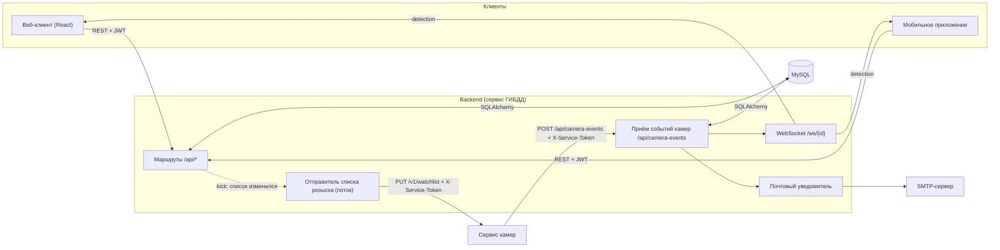

# Архитектура backend (сервис ГИБДД)

Backend написан на **FastAPI**: это асинхронный веб-фреймворк, который по аннотациям Python сам проверяет запросы и строит документацию (`/docs`). Данные хранятся в **MySQL**, доступ к ним через **SQLAlchemy**.

Backend это **сервис ГИБДД**. Камеры в него не входят: их изображает отдельный [сервис камер](../../camera-service/README.md), с которым backend общается по [протоколу](../../camera-service/docs/protocol.md). Общая картина проекта: [docs/architecture.md](../../docs/architecture.md).

## Общая схема



## Структура кода

```
backend/
  Dockerfile, docker-entrypoint.sh   образ и запуск в контейнере
  seed.py                  наполнение БД тестовыми данными
  seed_data.py             загрузка тестовых сотрудников из JSON
  seed_users.example.json  шаблон тестовых сотрудников
  requirements.txt
  tests/                   автотесты (unittest)
  app/
    main.py                создание приложения, подключение маршрутов, WebSocket
    database.py            подключение к БД, сессии (get_db)
    models.py              таблицы (SQLAlchemy)
    schemas.py             форматы запросов и ответов (Pydantic)
    auth.py                JWT: создание токена, get_current_user
    service_auth.py        проверка токена сервиса камер (X-Service-Token)
    routes/                HTTP-маршруты: auth, employees, vehicles, wanted, alerts, cameras, camera_events
    services/
      detection_rules.py   правила обработки события камеры (без БД, покрыты тестами)
      detections.py        обработка события: поиск розыска, создание оповещения в БД
      camera_client.py     отправка списка розыска сервису камер
      email.py             отправка писем
      export.py            сборка отчётов Word и Excel
    websocket/manager.py   хранение WebSocket-соединений
```

## Слои

| Слой | Файлы | Задача |
|---|---|---|
| Маршруты | `routes/*.py` | Принять запрос, проверить права, выполнить правило, вернуть ответ. Правила предметной области (например, «одна активная запись розыска на автомобиль») находятся здесь |
| Схемы | `schemas.py` | Описывают формат JSON; FastAPI по ним проверяет входные данные и формирует ответ |
| Модели | `models.py` | Таблицы базы данных и связи между ними, см. [database.md](database.md) |
| Сервисы | `services/*.py` | Независимая от HTTP логика: правила оповещений, работа с событиями камер, письма, отчёты, связь с сервисом камер |
| Инфраструктура | `database.py`, `auth.py`, `service_auth.py`, `websocket/` | Подключение к БД, токены, проверка сервисного секрета, соединения WebSocket |

Правила оповещений вынесены в `detection_rules.py` отдельно от работы с базой не случайно: они не зависят ни от БД, ни от FastAPI, поэтому проверяются быстрыми тестами без инфраструктуры, а `detections.py` остаётся тонкой прослойкой запросов.

## Жизненный цикл приложения

При старте (`lifespan` в `main.py`) сервер:

1. создаёт в БД недостающие таблицы (`Base.metadata.create_all`);
2. запускает фоновый поток `WatchlistPublisher`, если задан `CAMERA_SERVICE_URL`: он отправляет камерам список розыска.

При остановке поток аккуратно завершается.

В Docker перед стартом сервера скрипт `docker-entrypoint.sh` ждёт базу данных и заполняет её тестовыми данными (`seed.py`, безопасно запускать повторно).

## Как оповещение доходит до клиента

Событие приходит как обычный HTTP-запрос от сервиса камер, поэтому никаких фоновых потоков с таймерами и общих event loop здесь больше нет:

1. Сервис камер присылает `POST /api/camera-events`. Зависимость `require_service_token` проверяет `X-Service-Token`.
2. Маршрут `async def receive_camera_event` выполняет работу с базой в пуле потоков (`run_in_threadpool`, потому что SQLAlchemy синхронный): `process_camera_event` ищет камеру и розыск, применяет правила и создаёт запись `alerts`.
3. Затем маршрут (уже в event loop) вызывает `ConnectionManager.send_personal_message`, который отправляет JSON на WebSocket сотрудника и возвращает `True`, если сообщение ушло.
4. Если сообщение доставлено, `mark_notification_sent` ставит в `alerts.notification_sent` значение `true`.
5. Параллельно, если у сотрудника есть почта и настроен SMTP, письмо уходит в отдельном потоке.

Подробности правил: [camera-events.md](camera-events.md). Формат сообщения: [api.md](api.md#websocket-оповещения-в-реальном-времени).

## Как backend сообщает камерам о розыске

`WatchlistPublisher` (`services/camera_client.py`) работает в отдельном потоке. Маршруты, которые меняют розыск (добавление, передача, снятие и ответ «задержан»), после сохранения вызывают `watchlist_publisher.kick()`: поток просыпается и отправляет камерам свежий список `PUT /v1/watchlist`. Дополнительно список отправляется периодически. Отправка никогда не задерживает ответ пользователю.

## Соединения WebSocket

`ConnectionManager` хранит по одному соединению на сотрудника. Если сотрудник открыл страницу повторно (или React в режиме разработки смонтировал компонент дважды), новое соединение заменяет старое, а закрытие старого не удаляет новое: при отключении сравнивается именно объект соединения.

## Работа с базой

Каждый запрос получает собственную сессию через зависимость `get_db` и закрывает её по завершении. Обработка события камеры и отправитель списка создают свои сессии (`SessionLocal`) на каждый вызов, потому что сессии SQLAlchemy нельзя разделять между потоками.
