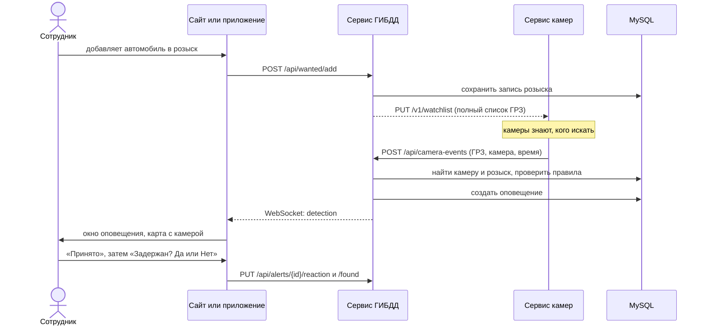

# Оповещения: как сервис ГИБДД работает с сервисом камер

Раньше оповещения создавал симулятор, встроенный в backend. Теперь камеры вынесены в **отдельный сервис** ([camera-service](../../camera-service/README.md)), а сервис ГИБДД сам оповещения не придумывает: он **реагирует на события**, которые присылают камеры. Формат обмена целиком описан в [протоколе](../../camera-service/docs/protocol.md), здесь разобрана сторона сервиса ГИБДД.

## Что делает сервис ГИБДД

1. **Отправляет камерам список разыскиваемых ГРЗ.** Камеры сами не знают, кого искать.
2. **Принимает события «камера увидела автомобиль»** на `POST /api/camera-events`, решает, нужно ли оповещение, создаёт его и доставляет сотруднику.

## Как обрабатывается событие

Код: [`services/detections.py`](../app/services/detections.py) (работа с базой) и [`services/detection_rules.py`](../app/services/detection_rules.py) (правила, без базы данных, поэтому покрыты тестами).

1. **Проверка токена.** Без верного заголовка `X-Service-Token` событие не принимается (`401`). Если `SERVICE_TOKEN` не задан вообще, приём закрыт (`503`).
2. **Повторная отправка.** Если событие с таким `event_id` уже обрабатывалось, ответ `ignored / duplicate`.
3. **Камера.** Ищется камера с кодом `camera_code`, она должна работать. Иначе `422`.
4. **Розыск.** Ищется активная запись розыска со статусом «В розыске» по этому ГРЗ. Нет такой: `ignored / not_wanted`.
5. **Правила частоты.** Смотрится последнее оповещение по этому розыску:
   - сотрудник на него ещё не ответил: `ignored / pending_alert`;
   - оно было меньше `ALERT_COOLDOWN_SECONDS` секунд назад: `ignored / cooldown`.
6. **Создание.** В записи розыска обновляются данные последней фиксации (дата, время, адрес и камера), создаётся запись в `alerts` со статусом «Ожидает».
7. **Доставка.** Сообщение `detection` уходит сотруднику по WebSocket. Если оно дошло, в `alerts.notification_sent` ставится `true`. Если нет, оповещение остаётся в базе и сотрудник увидит его при следующем открытии сайта. Письмо (если настроена почта) отправляется в любом случае.

Подробнее про сообщение WebSocket: [api.md](api.md#websocket-оповещения-в-реальном-времени).

### Правила частоты и зачем они нужны

Камеры могут присылать события часто, а сотрудник один. Без ограничений он получил бы десять окон подряд по одной и той же машине.

| Правило | Что предотвращает |
|---|---|
| `pending_alert` | Второе оповещение, пока не отвечено первое |
| `cooldown` | Новое оповещение сразу после того, как сотрудник ответил. Пауза по умолчанию 120 секунд, это больше, чем интервал вопроса «Задержан?» на сайте (60 секунд) |
| `duplicate` | Два оповещения из-за повторной отправки одного и того же события |

Эти правила заменили «паузу симулятора», которая раньше действовала, пока сотрудник не отвечал. Разница в том, что теперь клиенты не вызывают никаких служебных маршрутов («продолжить», «остановить»): сайту и приложению достаточно принимать оповещения.

Чтобы отключить паузу после ответа, поставьте `ALERT_COOLDOWN_SECONDS=0`. Ограничение «пока не отвечено» остаётся всегда.

## Как сервис ГИБДД отправляет список розыска

Код: [`services/camera_client.py`](../app/services/camera_client.py), класс `WatchlistPublisher`. Он запускается вместе с сервером (если задан `CAMERA_SERVICE_URL`) и работает в отдельном потоке.

- Отправляет полный список сразу при старте.
- После любого изменения розыска вызывается `watchlist_publisher.kick()`: поток просыпается и отправляет свежий список. Это происходит в маршрутах добавления, передачи и снятия розыска и при ответе «задержан».
- Раз в `WATCHLIST_RESYNC_SECONDS` (по умолчанию 30) отправляет список повторно, даже если ничего не менялось: так камеры «выздоравливают» после перезапуска.
- Если сервис камер недоступен, повторяет попытку каждые 5 секунд и сообщает об обрыве в журнале один раз, а не каждый раз.
- Сбой отправки никогда не мешает пользователям: ответ на «добавить в розыск» не ждёт камер.

В список попадают ГРЗ автомобилей с активной записью в статусе «В розыске».

## Что изменилось по сравнению с симулятором

| Было (симулятор внутри backend) | Стало (отдельный сервис камер) |
|---|---|
| Поток симулятора на каждого вошедшего сотрудника | Один сервис камер на всю систему |
| Клиенты вызывали `/api/simulator/start`, `/stop`, `/resume` | Таких маршрутов нет, клиенты их не вызывают |
| Оповещения создавались, только пока сотрудник вошёл | Оповещения создаются всегда, а непрочитанные ждут его в базе |
| Камеры выбирали автомобиль из записей одного сотрудника | Камеры получают общий список розыска и сообщают о любом автомобиле из него |
| Связь через общую память процесса и `runtime.main_loop` | Связь по HTTP-протоколу, сервисы можно перезапускать независимо |
| Настройка `DETECTION_INTERVAL_SECONDS` в backend | `CAMERA_INTERVAL_SECONDS` в сервисе камер |

## Настройка

| Переменная | По умолчанию | Назначение |
|---|---|---|
| `SERVICE_TOKEN` | нет | Общий секрет двух сервисов. Без него события не принимаются |
| `CAMERA_SERVICE_URL` | нет | Адрес сервиса камер. Без него список розыска не отправляется |
| `WATCHLIST_RESYNC_SECONDS` | `30` | Как часто список отправляется повторно |
| `ALERT_COOLDOWN_SECONDS` | `120` | Пауза между оповещениями по одному розыску |
| `APP_TIMEZONE` | `Europe/Moscow` | Часовой пояс для даты и времени оповещений |

Все переменные: [configuration.md](configuration.md).

## Ограничения

- Список уже обработанных `event_id` хранится в памяти процесса (последние 1000). После перезапуска сервиса ГИБДД повторная отправка очень старого события будет обработана заново; от повторов, которые приходят за секунды, защита работает.
- Камеры, которыми располагает сервис ГИБДД (таблица `cameras`), должны совпадать с камерами сервиса камер по кодам. Это проверяется тестом на согласованность ([test_contract_with_backend.py](../../camera-service/tests/test_contract_with_backend.py)).
- Один экземпляр сервиса ГИБДД. При нескольких экземплярах WebSocket-соединения и список обработанных событий нужно выносить во внешнее хранилище.
