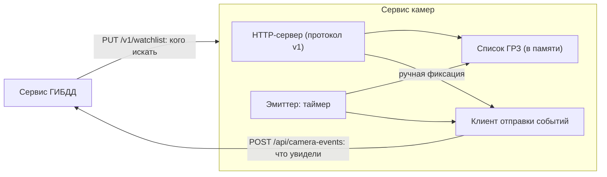

# Архитектура сервиса камер

## Место в системе

У сервиса нет базы данных. Единственное состояние это список разыскиваемых ГРЗ в памяти. Оно не теряется, потому что сервис ГИБДД присылает полный список при каждой отправке, в том числе периодически: после перезапуска сервис камер получит его снова за считанные секунды.

## Потоки

| Поток | Что делает |
|---|---|
| Главный | Принимает HTTP-запросы (`ThreadingHTTPServer`: каждый запрос обрабатывается в своём потоке) |
| `emitter` | Каждые `CAMERA_INTERVAL_SECONDS` секунд вызывает `Emitter.tick()` |

Список ГРЗ доступен обоим потокам, поэтому защищён блокировкой (`Watchlist` с `threading.Lock`). Метод `snapshot()` отдаёт копию, так что сервер может заменить список в момент, когда эмиттер выбирает из него автомобиль.

## Модули

| Модуль | Ответственность |
|---|---|
| `config.py` | Читает переменные окружения и проверяет их (число, минимум, логическое значение). Неверное значение даёт понятную ошибку при запуске |
| `cameras.py` | Загружает `cameras.json`, проверяет, что коды уникальны и поля заполнены |
| `watchlist.py` | Хранит список ГРЗ, приводит их к единому виду |
| `gibdd_client.py` | Отправляет событие, повторяет при сбоях сети и ошибках `5xx`, не повторяет `4xx` |
| `emitter.py` | Решает, что и когда отправить: `tick()` для таймера, `detect()` для ручной фиксации |
| `server.py` | Маршруты протокола, проверка токена, разбор JSON, ограничение размера тела |
| `main.py` | Связывает всё вместе, запускает потоки, останавливает по `SIGTERM` |

Модули не знают друг о друге лишнего: например, эмиттер получает клиента, список и камеры в конструкторе, поэтому в тестах вместо настоящих подставляются поддельные.

## Как выбирается событие

`Emitter.tick()`:

1. Берёт копию списка ГРЗ и список работающих камер. Если любой из них пуст, ничего не отправляет.
2. Случайно выбирает ГРЗ и камеру.
3. Создаёт событие: новый `event_id` (случайный UUID), `plate`, `camera_code` и текущее время в UTC с поясом.
4. Отправляет через `GibddClient`. Если доставить не удалось, пишет предупреждение в журнал и продолжает работу: сбой одного события не останавливает камеры.

## Остановка

Docker останавливает контейнер сигналом `SIGTERM`. Сервис перехватывает его, останавливает таймер и HTTP-сервер и завершается сам, не дожидаясь принудительного завершения.

## Почему без фреймворков

Сервис написан на стандартной библиотеке Python (`http.server`, `urllib`, `threading`):

- **Нет зависимостей**, поэтому образ Docker получается минимальным и собирается без доступа к PyPI.
- **Простая задача:** пять маршрутов, JSON, один токен. Фреймворк тут не окупился бы.
- **Проверяемость:** в тестах запускается настоящий сервер на свободном порту и настоящий сервер-заглушка вместо сервиса ГИБДД. Они общаются по сети, как в боевой работе.

Если сервис вырастет (много маршрутов, авторизация посложнее, документация OpenAPI), его стоит перенести на FastAPI: границы модулей к этому готовы, поменяется только `server.py`.

## Ограничения

- Один экземпляр. Список ГРЗ и таймер живут в памяти процесса.
- Выбор автомобиля и камеры случайный, привязки к реальным маршрутам нет.
- Нет шифрования канала: сервисы общаются по `http://` внутри сети Docker. Для боевой системы нужен HTTPS или закрытая сеть между сервисами.
