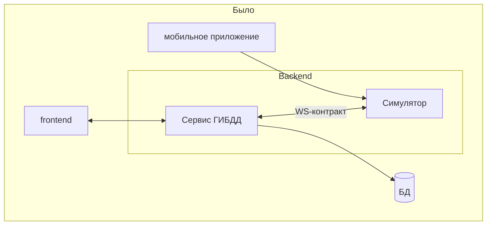
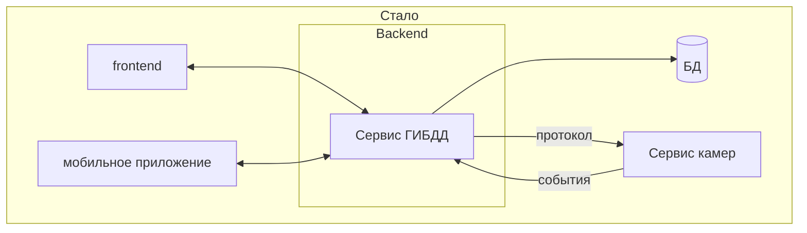

# Архитектура системы

## Из чего состоит система

| Часть | Что делает | Где живёт |
|---|---|---|
| **Сервис ГИБДД** (backend) | Хранит розыск, принимает действия сотрудников, принимает события от камер, создаёт оповещения и доставляет их клиентам | [backend/](../backend/README.md) |
| **Сервис камер** | Изображает камеры видеофиксации: знает, какие ГРЗ искать, и сообщает сервису ГИБДД, где и когда увидел автомобиль | [camera-service/](../camera-service/README.md) |
| **База данных** | MySQL; обращается к ней только сервис ГИБДД | контейнер `db` |
| **Веб-интерфейс** | Сайт сотрудника | [web-frontend/](../web-frontend/README.md) |
| **Мобильное приложение** | Приложение сотрудника на Android | [AvtoDozor/](../AvtoDozor/README.md) |

Клиенты (сайт и приложение) разговаривают **только с сервисом ГИБДД**. Сервис камер им неизвестен: оповещение для них это сообщение `detection` по WebSocket, откуда бы оно ни взялось.

## Что изменилось

Раньше симулятор камер был модулем внутри backend: он жил в том же процессе, общался с сервисом ГИБДД через общую память и «WS-контракт», а клиенты управляли им служебными вызовами (запустить, остановить, продолжить).

Теперь симулятора внутри backend нет. Камеры вынесены за его пределы в отдельный сервис, и все общаются по протоколу.

### Зачем камеры вынесены в отдельный сервис

- **Это ближе к реальности.** Настоящие камеры никогда не будут частью сервера розыска. Сервис ГИБДД уже умеет принимать события по протоколу, поэтому имитацию можно заменить настоящей системой, не меняя его.
- **Независимость.** Сервисы запускаются, перезапускаются и обновляются по отдельности. Если камеры недоступны, розыск продолжает работать, а если недоступен сервис ГИБДД, камеры повторяют отправку.
- **Чище границы.** В backend больше нет потока с таймером, общего event loop и служебных маршрутов управления. Он только принимает запросы и события.
- **Проще клиентам.** Сайт и приложение перестали вызывать `start`, `stop` и `resume`: им достаточно принимать оповещения.
- **Масштабирование.** Камер может быть сколько угодно, а сервис ГИБДД не растёт вместе с ними.

## Три основных сценария

### 1. Сотрудник меняет розыск

1. Сотрудник на сайте или в приложении добавляет автомобиль в розыск: `POST /api/wanted/add`.
2. Сервис ГИБДД сохраняет запись и отвечает сотруднику.
3. В фоне он отправляет сервису камер **полный актуальный список** разыскиваемых ГРЗ: `PUT /v1/watchlist`.

Так же отправляется список после передачи, снятия розыска и ответа «задержан».

### 2. Камера видит автомобиль

1. Сервис камер выбирает ГРЗ из списка и камеру и отправляет событие: `POST /api/camera-events`.
2. Сервис ГИБДД проверяет токен, находит камеру и розыск и решает по правилам (оповещение не повторяется, пока на предыдущее не ответили, и не чаще заданной паузы).
3. Создаётся оповещение, и сообщение `detection` по WebSocket уходит сотруднику, который ведёт этот розыск.
4. Сайт или приложение показывает окно оповещения и карту с подсвеченной камерой.

### 3. Сотрудник отвечает

1. «Принято»: `PUT /api/alerts/{id}/reaction`.
2. Через заданное время вопрос «Автомобиль задержан?», ответ: `PUT /api/alerts/{id}/found`.
3. «Да» переводит автомобиль в статус «Найден», сервис ГИБДД отправляет камерам обновлённый список без него, и оповещения по нему прекращаются. «Нет» оставляет розыск.

## Кому принадлежат данные

| Данные | Хозяин | Копия |
|---|---|---|
| Розыск, сотрудники, оповещения | Сервис ГИБДД (база данных) | Список ГРЗ у сервиса камер, в памяти |
| Список камер | Сервис камер (`cameras.json`) | Справочник `cameras` в базе ГИБДД нужен, чтобы хранить историю оповещений и находить камеру по коду |

Обе копии списка камер должны совпадать по кодам; это проверяется автоматическим тестом ([test_contract_with_backend.py](../camera-service/tests/test_contract_with_backend.py)).

## Подробнее

| Вопрос | Документ |
|---|---|
| Формат сообщений между сервисами | [camera-service/docs/protocol.md](../camera-service/docs/protocol.md) |
| Как сервис ГИБДД обрабатывает события | [backend/docs/camera-events.md](../backend/docs/camera-events.md) |
| Как запустить всё одной командой | [docker.md](docker.md) |
| Устройство сервиса камер | [camera-service/docs/architecture.md](../camera-service/docs/architecture.md) |

## Транспорт камер

Обмен с сервисом камер — **WebSocket** (одно соединение на камеру). См. [camera-service/docs/protocol.md](../camera-service/docs/protocol.md).
